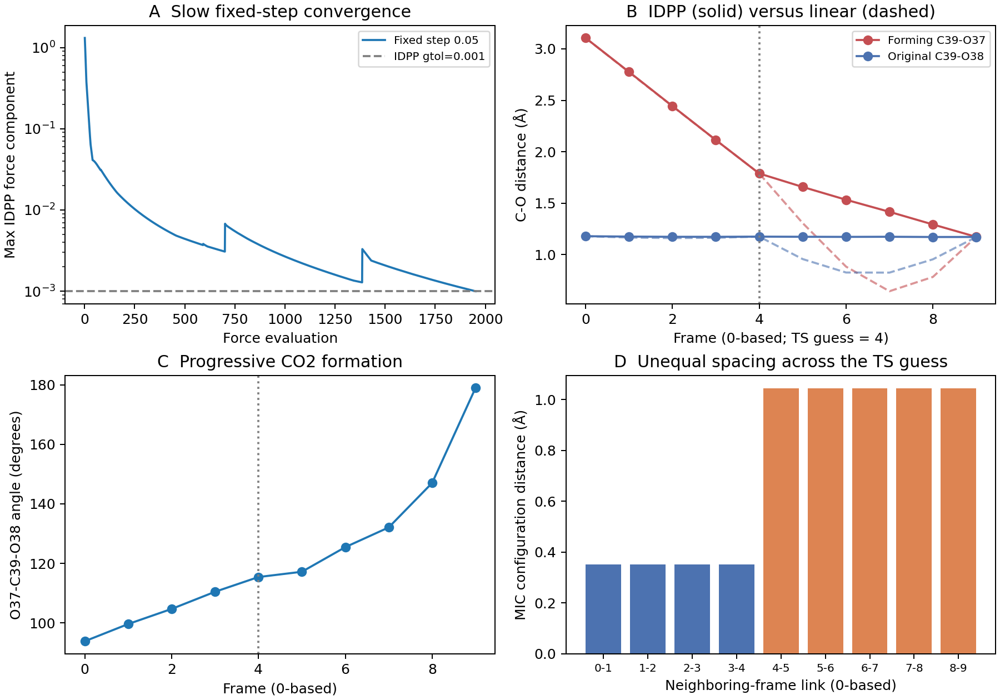

# Dynamic MIC IDPP repair — 2026-11-12

Status: local source validation; not published or deployed.

## Failure and repair

Baseline ATST commit: `6c71420142d138eea9dec5f6d98d1e8ee28cf989`.
The old solver selected per-pair lattice translations once at initialization.
After an atom pair crossed a nearest-image boundary, the objective and gradient
continued using the old image, allowing a real MIC contact to collapse while
the solver saw a long distance. Raw neighboring-frame displacements also made
wrapped endpoints contribute artificial tangent/spring jumps.

The repair evaluates upper-triangle pair MIC vectors from current coordinates
at every force evaluation, then fills the reverse pairs antisymmetrically.
Neighboring-frame MIC displacements define the shortest-periodic-path spring
and tangent. Partial PBC and explicit `mic=False` are respected. The final
objective and force now describe the returned coordinates. Undefined overlaps
and nonfinite geometry fail explicitly. ASE resolves MIC ties deterministically;
the selected equal-length vector may differ from the historical scan order.

Shared contact facts replace the CCQN-local implementation while preserving
its advisory behavior. Generated path publication and D2S rough NEB calculator
setup reject contacts below half the summed ASE covalent radii. This heuristic
does not establish physical validity and does not equate nonconvergence with
collision. Normal short H-H bonds remain accepted.

## Original Pd/CO replay

Read-only source, SAI account `galileouser02`:

```text
/org/galileo-group/galileouser02/adam-cli-local/runs/
paimon-paper-pd-co-d2s-clean-20261112-v1/
bde8a43192f04d0495292c6b62d88ff9/task/PdCO_D2S_clean/
PdCO_NEB_explore_flatFS/prepared_endpoints/
  ts_guess/ts_guess.extxyz
  final/final.extxyz
```

The above wrapped lines form one directory prefix. Downloaded original hashes:

- TS: `c55aec30fc59af0eb79d59f660ecf76a62299a95b5c3dc19c14e2de68163206b`.
- FS: `6cb62a30aee13409c4ffb6f6ced599d51b3447014bbd05ea5c508f282247d2fa`.

Both variants used `Fast_IDPPSolver.from_endpoints(TS, FS, 4)` and the historical
fixed-step update, with default `gtol=1e-3` and unchanged weights. To reproduce
the repaired **1951-evaluation** result on the current source, explicitly call
`run(maxiter=2000, tol=0.05, optimizer="legacy")`. The original baseline did
not yet expose the optimizer argument. Current default FIRE instead converges
in 234 evaluations for this TS-to-FS segment, as recorded below.
No atom remapping, DFT evaluation or scientific input changes were made.

| Measurement | Baseline | Repaired |
| --- | ---: | ---: |
| Status | Failed | Converged |
| Iterations | 2000 | 1951 |
| Reported maximum IDPP force | 0.0522651117 | 0.0009986879 |
| Pd16–Pd28, fourth interior frame (Å) | 0.2050694 | 2.7670751 |
| Minimum Pd–Pd across all frames (Å) | 0.2050694 | 2.7391817 |
| Final objective | 6.1486674 | 0.0322360 |
| Local elapsed time (s) | 1.35 | 12.25 |

The baseline force/objective are its historical pre-displacement report; the
repaired report is evaluated at the returned geometry. Timings are single local
observations with `OPENBLAS_NUM_THREADS=1`, not a controlled performance benchmark.
Dynamic MIC adds cost. An initial replay before batching neighboring-frame MIC
took 13.70 s; the final-source replay took 12.25 s with identical numerical results.

Durable geometry/constraint fixtures and their regression live in
[`tests/data/idpp_pd_flat_fs`](../../tests/data/idpp_pd_flat_fs/README.md).
Local original files, replay script, trajectories, JSON results and raw test
logs are retained at `/home/james/scratch/idpp-mic-20261112/`.

## Verification and limits

Environment: `/home/james/apps/miniforge3/envs/atst-dev/bin/python`, ASE 3.28.0,
NumPy 2.2.6, SciPy 1.15.2. Every check explicitly sets `PYTHONPATH` to this
checkout's `src`; the environment's installed editable points elsewhere.

Focused regressions cover current-coordinate branch crossing, finite-difference
gradient agreement away from branch ties, periodic spring invariance, final
report consistency, constraints, nonfinite/overlap rejection, preservation of
existing output on rejection, valid H2, and collision rejection before D2S
calculator setup.

- Solver suite, including the durable original Pd fixture: **51 passed**.
- Remaining complete offline unit suite: **1483 passed, 13 skipped** in 74.84 s.
  Skips cover installed abacuslite defaults, absent built distributions,
  optional real inputs/toolbox imports and an unconfigured DeepMD model.
- Documentation governance and `git diff --check`: passed.
- Independent whole-change review: no blocking findings; five public CLI
  `neb_make` consumer tests additionally passed.
- Direct guard check of the original output: rejects image 5 (including the
  first endpoint in 1-based numbering), Pd16–Pd28 at 0.205 Å against 1.390 Å.
  Repaired output passes; its minimum covalent-radius ratio is 0.8241.

The two unit runs together cover **1534 passed, 13 skipped** on the final source.
Raw logs: `solver-green.log`, `integrated-unit.log`, `docs-check.log` in the
local evidence directory above. Earlier RED tests in `solver-red.log` and
`geometry-d2s-red.log` demonstrate sensitivity to the defects.

This establishes an interpolation repair, not a validated transition state or
DFT NEB result. The running custom-chain NEB was not replaced. Deployment and
release/gitlink integration remain separate from these local changes.

## Follow-up assessment: iteration mode and initial-chain quality

The maintainer requested a bounded assessment of these two questions after
the repair. The following experiments preceded the production optimization
documented at the end of this report; they ran no DFT calculations.

### Iteration efficiency

All variants used the same TS/flat-FS input, four intermediate frames, current
MIC, pair targets/weights, spring constant 5, constraints, objective-residual
threshold 0.05, and maximum force-component threshold 0.001. Fixed descent
clips individual displacement components at 0.05 Å. The experimental ASE FIRE
adapter uses `dt=0.1`, `dtmax=1.0`, `maxstep=0.2`, and the exact ATST force
evaluation. It explicitly checks the ATST stopping criterion, rather than
FIRE's native maximum per-atom vector norm. Counts include the initial force
evaluation; they are not all displacement updates.

| Mode | Force evaluations | Seconds | Outcome | Maximum atom MIC difference from fixed 0.05 final chain (Å) |
| --- | ---: | ---: | --- | ---: |
| Fixed step 0.05 | 1951 | 13.16 | Converged | 0 |
| Fixed step 0.1 | 936 | 6.48 | Converged | 0.0170 |
| Fixed step 0.2 | 2001 | 14.54 | Failed, max component 0.212 | 0.7295 |
| ASE FIRE | 234 | 1.53 | Converged | 0.00834 |

These single-run local timings use one BLAS thread. FIRE reached essentially
the same band with about 8.3 times fewer evaluations and 8.6 times less elapsed
time. Its minimum Pd–Pd distance is 2.73867 Å; endpoint positions and frozen
atoms are unchanged, and the shared geometry guard accepts the band.

The fixed-step baseline first reaches force thresholds 0.01, 0.005 and 0.001
at evaluations 256, 445 and 1951. Stopping at the first two leaves maximum
atomic differences of 0.234 and 0.174 Å relative to the tighter result, mainly
in the rotating adsorbate. At evaluation 1000 the remaining maximum difference
is 0.0657 Å. Thus loosening the force threshold is not a free speed improvement.
The objective-change threshold is already satisfied much earlier; the force
criterion controls the slow tail.

Recommendation: develop an optional FIRE mode first, retaining current MIC,
constraints, final-state checks and explicit convergence status. Keep an
iteration cap as a safety budget, rather than solving this case by increasing
2000 to a larger number. Cross-system checks are needed before changing the
default algorithm. Do not select fixed step 0.2 or relax the force criterion
based on collision avoidance alone. The existing numerical IDPP force is not
a DFT force or an estimate of the physical NEB convergence.

The [ASE NEB documentation](https://docs.ase-lib.org/ase/neb.html) allows
optimizer choice for IDPP; its default IDPP implementation uses MDMin. This
experiment tests FIRE on ATST's existing force, not a switch to ASE's distinct
IDPP objective or a claim that FIRE is universally superior.

### Full IS → TS-input → flat-FS chain

The complete reconstructed chain contains ten frames (including endpoints and
the TS-input frame), with three internal images before the TS input and four
after it. The IS-to-TS segment converges in 196 evaluations. All measurements
below use true MIC; frame indices in the data/figure are 0-based.

| Quantity | IS, frame 0 | TS input, frame 4 | Frame 6 | Flat FS, frame 9 |
| --- | ---: | ---: | ---: | ---: |
| Forming C39–O37 distance (Å) | 3.106 | 1.788 | 1.533 | 1.172 |
| Original C39–O38 distance (Å) | 1.178 | 1.174 | 1.171 | 1.171 |
| O37–C39–O38 angle (degrees) | 93.85 | 115.42 | 125.46 | 178.96 |
| Nearest C–Pd distance (Å) | 2.027 | 2.101 | 2.645 | 3.585 |

The forming bond shortens monotonically, the original CO bond stays within
1.170–1.178 Å, the molecular angle opens progressively, and the carbon moves
away from the surface. Minimum Pd–Pd across the complete chain is 2.705 Å
(the initial endpoint); the TS-to-FS portion remains above 2.739 Å. The largest
mobile-Pd displacement from IS is 0.164 Å and frozen-atom drift is zero. No
severe interatomic collision is detected. Direct Cartesian linear interpolation
instead compresses the forming C–O to 0.643 Å and the original C–O to 0.824 Å.

Two limitations remain despite locally converged segments:

- Configuration-space MIC link lengths are 0.3525 Å before the TS input and
  1.0430–1.0432 Å after it, a 2.96-fold spacing mismatch. The latter portion
  includes atomic steps up to 0.779 Å and the last OCO-angle change is about
  32 degrees. Equalizing each segment separately does not equalize the full
  band. More sampling is needed on the longer rotation/desorption portion,
  while retaining sufficient resolution near bond formation.
- The angle between consecutive configuration-space displacement vectors at
  the TS-input join is 70.27 degrees. This is a path tangent kink, not a bond
  angle. The two segment optimizations do not couple tangents across their
  common endpoint; extra iterations of either segment cannot fix that by
  themselves. A subsequent whole-band NEB can relax the interior TS-input
  image. The maintainer subsequently clarified that an explicit TS reflects
  intentional input or continuation and must be retained during generation;
  no TS-moving smoothing option is to be added.

The last raw Cartesian Pd step is 8.386 Å because of endpoint wrapping, while
its corresponding physical MIC displacement is small. Installed ASE 3.28.0
`ase.mep.neb.Spring._find_mic` uses MIC for inter-image spring vectors; raw
coordinate jumps alone are therefore not a failure of this NEB input.

Conclusion: the band is a geometrically usable, chemically interpretable NEB
initial guess, but not an optimized global band or validated reaction pathway.
IDPP cannot certify the TS input as a saddle, locate metastable intermediates,
or decide the energetically preferred timing of CO2 formation, rotation and
desorption. Those questions require the physical potential/DFT forces.



Data: [optimizer comparison](data/idpp_pd_audit_20261112/comparison.json),
[iteration checkpoints](data/idpp_pd_audit_20261112/baseline_history.json),
[full-chain geometry](data/idpp_pd_audit_20261112/audit.json).
Reproduction scripts and all experimental trajectories are retained in
`/home/james/scratch/idpp-mic-20261112/optimizer-study/` (`study.py`, `history.py`)
and `geometry-study/` (`audit.py`, `plot.py`). Parent inspection verified the
optimizer force adapter, equal stopping conditions and saved results; direct
guard and frozen-atom checks also passed for the complete/FIRE bands.

## Production optimization and maintainer ruling

The maintainer approved production optimization and clarified the scope:
ordinary IDPP takes IS/FS, while an explicitly supplied TS represents user
knowledge or continuation. Preserve that anchor and do not add a TS-moving
option. The implementation therefore changes the update scheme and segment
allocation only; the 70-degree join is not a mandate to override the input.

- `Fast_IDPPSolver.run(optimizer="fire")` is the default; `legacy` preserves
  clipped fixed-step updates and their `step_size`/`max_disp` controls. FIRE
  retains the original force, constraints and stopping conditions. Empty
  intermediate bands return their endpoints without optimization.
- Python generation/interpolation, CLI `--idpp-optimizer`, YAML
  `make.idpp_optimizer` and D2S `neb.idpp_optimizer` expose this choice.
- Explicit TS generation defaults to `image_distribution="length"`
  (`--image-distribution` or `make.image_distribution`), apportioning segment
  interval counts by MIC endpoint chords. At least one extra image per moving
  segment is retained when the image budget permits. `equal` restores the old
  half split. Chord lengths estimate rather than guarantee final arc lengths.
- TS positions are retained after the requested index alignment, and total
  counts remain `n_images+2` without TS and `n_images+3` with TS. Existing-chain
  reuse and restart do not apply generation sampling again.

Final production replay with the original Pd files and seven extra images:

| Route | Evaluations | Total frames | Elapsed (s) | Largest/smallest MIC link length | TS position |
| --- | ---: | ---: | ---: | ---: | --- |
| IS/FS, ordinary default | 265 | 9 | 3.17 | 1.00021 | Not supplied |
| Explicit TS, equal allocation (3+4) | 33 + 234 | 10 | 1.60 | 2.96051 | Retained exactly, frame 4 |
| Explicit TS, length allocation (1+6) | 33 + 192 | 10 | 1.95 | 1.06340 | Retained exactly, frame 2 |

All runs converged, preserved endpoints and frozen atoms, and passed the
contact guard. The full-chain minimum Pd–Pd remains 2.70488 Å (IS endpoint).
The new segmented link lengths are approximately 0.7044 / 0.7490 Å, versus
0.3525 / 1.0436 Å for the equal split. The retained-anchor join angle remains
68.87 degrees; ordinary IS/FS has no internal TS join and its largest local
turn is 32.01 degrees. Frame indices here are 0-based. These local timings
are observations, not performance guarantees.

Pre-review offline record (atst-dev / ASE 3.28): **1571 passed, 13 skipped** in
70.05 s, plus document
governance and whitespace checks. Coverage includes Pd ordinary/segmented
generation, Pt13 slab, nonperiodic/partial-periodic molecules, disabled MIC,
mixed constraints, final reporting, legacy updates, zero-interior bands,
allocation edge cases, public CLI/config and D2S forwarding. All tests explicitly
import this checkout. Logs: `optimization-full-unit.log`, `optimization-docs.log`
under the existing evidence directory. Independent whole-change review passed
without blocking findings, including FIRE's actual ASE stepping semantics,
allocation budgets, TS retention, and existing-chain/restart bypass behavior.
No DFT rerun, deployment, dependency installation or publication.

The [production replay data](data/idpp_pd_audit_20261112/production_results.json)
and `/home/james/scratch/idpp-mic-20261112/production-optimization/replay.py`
retain the observed geometries and reproduction recipe. The full pre-optimization
source/tests/docs snapshot is in `optimization-baseline/`; the review snapshot
is in `optimization-review/` under the same evidence directory.

## Collaborator review follow-up

The collaborator correctly identified a user-reference wording violation
(`stopping test` → `stopping criterion`) and an ambiguous historical reproduction
command. The 1951-evaluation replay now explicitly selects `optimizer="legacy"`;
the current default FIRE produces 234 evaluations. Both counts were reproduced
on abacus-env / ASE 3.29.0 after the corrections.

The earlier 1571-pass record is historical, not final-state evidence: subsequent
reference wording triggered a governance failure in the collaborator's run
(1575 passed, 8 skipped, 1 failed). The current verification below supersedes it.

Two boundary clarifications were implemented with failing-before/passing-after
regressions:

- Construction already validates endpoint overlaps. `run()` now rechecks both
  endpoints once, before any iteration, because its public image objects may
  have been edited since construction. This includes zero-interior bands;
  endpoints are not redundantly checked in every force evaluation.
- `path_contact_facts` restores `{}` for fewer than two frames. The geometry
  validator separately measures single-frame contacts, so a one-frame overlap
  is still rejected. CCQN's former empty-path-summary behavior is retained.

Environment: Python 3.12 at
`/home/james/apps/miniforge3/envs/abacus-env/bin/python`; ASE 3.29.0,
NumPy 2.5.2, SciPy 1.18.0, abacuslite 1.2.2. The current checkout's `src` was
explicitly selected by `PYTHONPATH`, and its import origin was verified.
Focused solver/contact/documentation suites passed **95 tests**. Raw outputs:
`review-followup-red.log`, `review-followup-targeted.log`,
`review-followup-replay.log` in the existing evidence directory.

Final full unit suite on this environment: **1581 passed, 8 skipped, 0 failed**
in 49.82 s (exit code 0). Evidence: `review-followup-full.log` in the same
directory. This includes the corrected documentation test and five new endpoint
and single-frame regression cases.

Delivery inventory: `tests/data/idpp_pd_flat_fs/` contains README plus three
endpoint files; `docs/reports/data/idpp_pd_audit_20261112/` contains four JSON
records plus the audit PNG. All nine files are present. Commit preparation found that the global `*.json`
ignore rule excluded the four audit JSON files; a directory-specific exception
now includes them. Both directories are included in the ATST commit alongside
source, tests and documentation. No external publication was performed.
